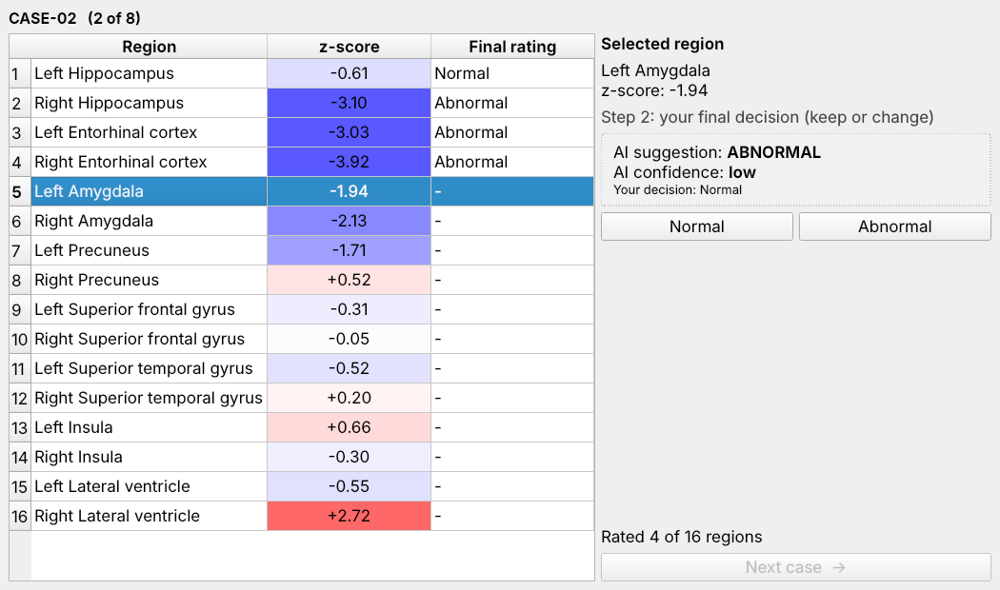
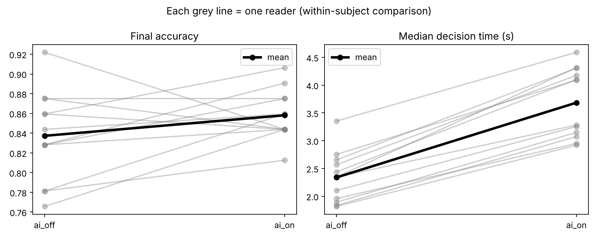
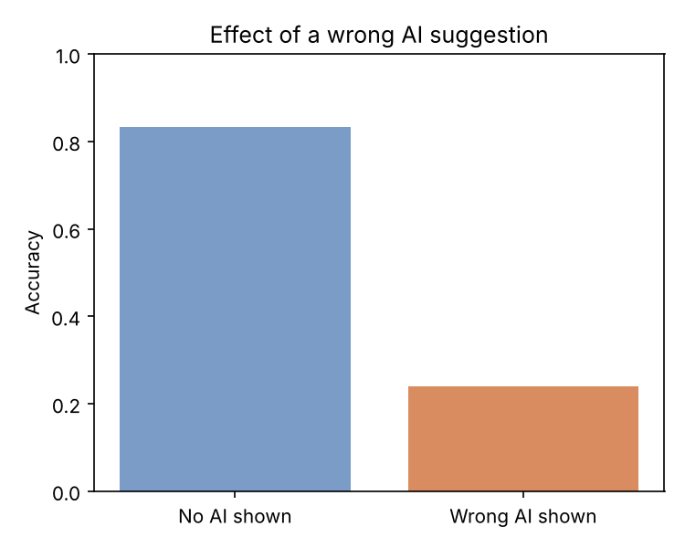

# Brain Morphometry Viewer — Interaction Logging Prototype

A small exploratory prototype for **data-driven human–computer interaction (HCI)** in
clinical decision support. It shows how user behaviour can be logged in a PyQt5 desktop
GUI for brain-morphometry results and then analysed, for example to measure how an AI
suggestion influences a reader's decisions (accuracy, decision time, automation bias).

I built it to understand the practical questions behind evaluating morphometry software
such as [ScanOMetrics](https://github.com/scan-nrad/scanometrics) in real use:
*what should be logged, how should it be stored, and how can it be analysed?*

> **Data note:** all case data and session logs in this repository are **synthetic or
> simulated**. No real patient data is used. The results in the notebook only
> demonstrate the analysis pipeline. They are not study findings.



## What it does

1. **Viewer** (`src/viewer.py`, PyQt5): shows regional z-scores for each case (deviation
   from a normative reference; blue = smaller, red = larger than expected). The
   participant rates each region as *Normal* or *Abnormal*.
2. **Within-subject AI condition:** for a random half of the cases (reproducible per
   participant), an AI suggestion appears next to the selected region; for the other
   half it is hidden.
3. **Interaction logger** (`src/logger.py`): every action (case opened, region selected,
   AI suggestion shown, rating) is written as one row to a per-session CSV with a fixed
   schema, monotonic timing and only a pseudonymous participant ID.
4. **Analysis** (`analysis/analysis.ipynb`): accuracy and decision time with vs. without
   AI (paired Wilcoxon test), plus an automation-bias check: how often users follow
   the AI when it is wrong.

| Accuracy & time by condition | Effect of a wrong AI suggestion |
|---|---|
|  |  |

## Log schema

| column | meaning |
|---|---|
| `timestamp_utc` | wall-clock time (ISO 8601) |
| `session_id` / `participant_id` | random session ID / pseudonymous participant ID |
| `case_id`, `ai_condition` | case on screen; `ai_on` or `ai_off` |
| `event` | `session_start`, `case_open`, `region_select`, `ai_suggestion_shown`, `rating`, `case_complete`, `session_end` |
| `region`, `z_score` | region involved and its z-score |
| `ai_flag` | AI suggestion shown (1 = abnormal), if any |
| `rating` | participant's decision (1 = abnormal) |
| `ground_truth` | true label, stored for analysis only and never shown |
| `ms_since_case_open` | time since the case was opened (monotonic clock) |

## Run it

```bash
pip install -r requirements.txt

python data/make_sample_cases.py      # create the synthetic cases
python src/viewer.py                  # run the viewer; logs go to logs/
python scripts/simulate_sessions.py   # optional: simulated logs for testing the analysis
jupyter notebook analysis/analysis.ipynb
```

## Project structure

```
data/      synthetic cases + generator script
src/       viewer (PyQt5) and interaction logger
scripts/   simulated-session generator, notebook builder
analysis/  analysis notebook
figures/   generated plots
logs/      session logs (real session logs are git-ignored)
```

## Limitations and possible next steps

- Simulated data and a deliberately simple behaviour model.
- A real study would need ethics approval, informed consent, realistic cases,
  radiologists as participants and a sample-size calculation.
- Possible extensions: per-decision confidence ratings, hover/dwell time, comparing
  explanation designs (showing *why* the AI flagged a region), and mixed-effects models
  for multi-site data.

## License

MIT
