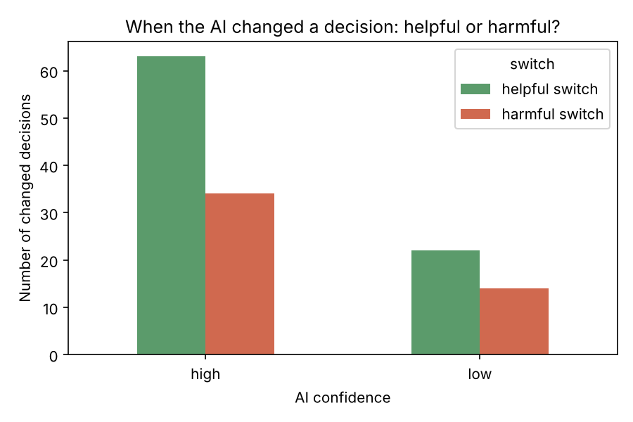
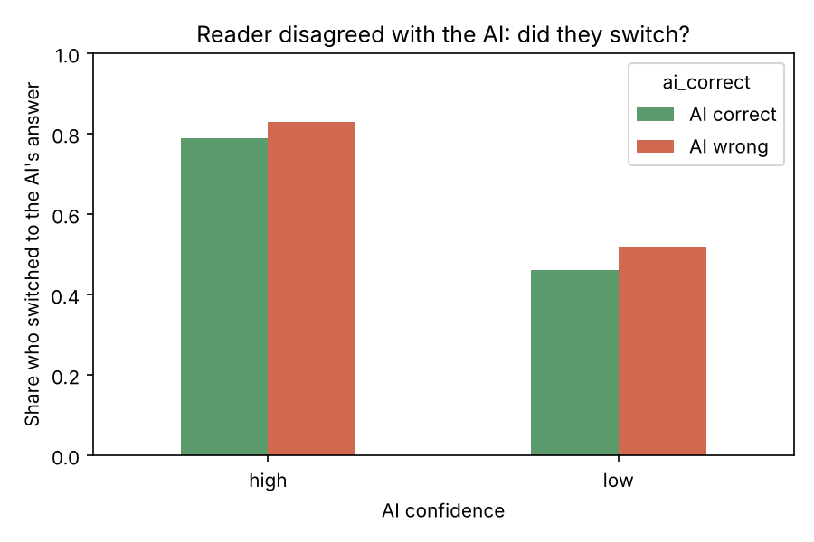

# Brain Morphometry Viewer: Interaction Logging Prototype

[](https://colab.research.google.com/github/iRosses-omics/brain-viewer-interaction-logger/blob/main/analysis/analysis.ipynb)

A small exploratory prototype for **data-driven human–computer interaction (HCI) in clinical
decision support**. It shows how reader behaviour can be logged in a PyQt5 desktop GUI for
brain-morphometry results, and how those logs can be analysed to measure how AI advice
influences decisions: accuracy, decision time, automation bias and calibrated trust.

I built it to understand the practical questions behind evaluating morphometry software such as
[ScanOMetrics](https://github.com/scan-nrad/scanometrics) in real use: **what should be logged,
how should it be stored, and how can it be analysed?**

> **Data note:** all case data and session logs in this repository are synthetic or simulated.
> No real patient data is used. The results only demonstrate the analysis pipeline. They are not study findings.


## The study protocol: decide first, then see the AI

For every brain region, the reader:

1. sees the region's **z-score** (deviation from a normative reference; blue = smaller, red = larger than expected),
2. gives their **own decision** first: Normal or Abnormal,
3. in `ai_on` cases, then sees the **AI suggestion with its confidence (high / low)** and gives a **final decision**: keep or change.
   In `ai_off` cases, the first decision is final.

Half of the cases are `ai_on`, chosen at random but reproducibly per participant (within-subject design).

**Why decide first?** Because the decision is recorded *before* and *after* the advice, we can see
exactly when the AI changed someone's mind, whether that change helped or hurt, and whether readers
rely less on low-confidence advice. Asking for an independent decision first may also reduce
automation bias itself, which is a design question a real study could test.

## What is in the repository

| Part | File | What it does |
|---|---|---|
| Viewer | `src/viewer.py` | PyQt5 GUI implementing the protocol above |
| Logger | `src/logger.py` | Writes every action as one row of a per-session CSV with a fixed schema |
| Cases | `data/make_sample_cases.py` | Synthetic morphometry results with noisy z-scores, a hidden ground truth, and a simulated AI with confidence |
| Simulator | `scripts/simulate_sessions.py` | Simulated readers, so the analysis can be tested before real users exist |
| Analysis | `analysis/analysis.ipynb` | Accuracy and time (paired Wilcoxon), before/after switches, automation bias, calibrated trust, and a mixed-model sketch |

**Logger design choices:** fixed schema with a `schema_version` column; each row is flushed to disk
immediately (nothing is lost if the app crashes); durations use a monotonic clock; participants
appear only as a pseudonymous ID; the ground truth is stored for analysis but never shown.

## Example output (simulated data)

| Accuracy and time by condition | When the AI changed a decision |
|---|---|
|  |  |

| Disagreed with the AI: did they switch? |
|---|
|  |

In the simulated data, readers switched to wrong advice almost as often as to correct advice
(automation bias), but switched less when the AI's confidence was low (calibrated trust).

## Log schema

| column | meaning |
|---|---|
| `schema_version` | version of the column layout |
| `timestamp_utc` | wall-clock time (ISO 8601, UTC) |
| `session_id` / `participant_id` | random session ID / pseudonymous participant ID |
| `case_id`, `ai_condition` | case on screen; `ai_on` or `ai_off` |
| `event` | `session_start`, `case_open`, `region_select`, `rating_initial`, `ai_suggestion_shown`, `rating_final`, `case_complete`, `session_end` |
| `region`, `z_score` | region involved and its z-score |
| `rating` | reader's decision (1 = abnormal) |
| `ai_flag`, `ai_confidence` | AI suggestion (1 = abnormal) and its confidence, when shown |
| `ground_truth` | true label, stored for analysis only and never shown |
| `ms_since_case_open` | time since the case was opened (monotonic clock) |

## Run it

The analysis runs in Google Colab with one click (badge above). The viewer is a desktop app, so run it locally:

```bash
pip install -r requirements.txt

python src/viewer.py                  # run the viewer; logs go to logs/
python data/make_sample_cases.py      # optional: regenerate the synthetic cases
python scripts/simulate_sessions.py   # optional: regenerate the simulated logs
python scripts/build_notebook.py      # optional: rebuild the notebook
jupyter notebook analysis/analysis.ipynb
```

## Project structure

```
data/      synthetic cases + generator script
src/       viewer (PyQt5) and interaction logger
scripts/   simulated-session generator, notebook builder
analysis/  analysis notebook
figures/   generated plots
docs/      screenshot
logs/      session logs (real session logs are git-ignored)
```

## Limitations and next steps

- Simulated data and a deliberately simple behaviour model.
- A real study needs ethics approval at each site, informed consent from the readers,
  pseudonymised patient data, realistic cases, radiologists as participants and a sample-size calculation.
- Readers rate many regions and cases, so a real analysis should use mixed-effects models
  (random effects for reader and case; a multi-reader multi-case design).
- Next steps: connect the logger to real ScanOMetrics output; run a small pilot;
  compare interface designs (advice first vs. decide first); show an uncertainty interval next to
  each z-score and test whether it improves calibrated trust.

## License

MIT
